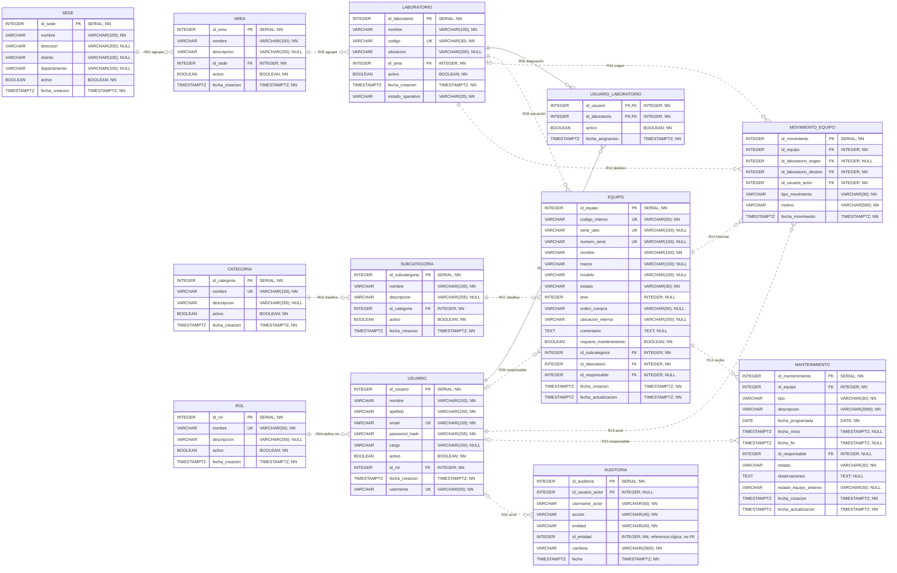

# ERD físico PostgreSQL v3 — Inventario de Laboratorios

La fuente de verdad es [Flyway V1–V13](../../backend/inventario/src/main/resources/db/migration/),
contrastada con las [12 Entities JPA](../../backend/inventario/src/main/java/com/utec/inventario/entity/).
Revisión estática del 11 de octubre de 2026: **12 tablas, 98 columnas, 12 PK y 16 FK**.
`flyway_schema_history` es infraestructura y no integra el modelo de negocio.
Esta tarea documenta la estructura; no ejecuta migraciones ni modifica datos.

[Abrir diagrama ampliable SVG](erd-fisico-v3.svg) · [Imagen PNG](erd-fisico-v3.png) ·
[Fuente Graphviz editable](erd-fisico-v3.dot) · [ERD lógico](erd-logico-v3.md)

## Leyenda y alcance

PK: clave primaria. FK: clave foránea. UK: unicidad individual. NN: NOT NULL.
NULL: admite ausencia. SERIAL crea una columna INTEGER con secuencia; no es un
tipo ENUM. Se conservan nombres SQL, longitudes, nullability y DEFAULT de Flyway.
La nulabilidad del diagrama refleja SQL, no la opcionalidad de un campo de un DTO.
Las restricciones compuestas, funcionales y parciales se detallan después.

## Diagrama editable en Mermaid

## Diccionario de columnas

Los DEFAULT son valores de inserción del esquema. `fecha_actualizacion` no tiene
trigger de actualización en estas migraciones: su actualización la coordina Java.
`password_hash` se incluye solo como nombre de columna de persistencia; no se
incluyen valores ni credenciales y no forma parte de las respuestas públicas.

### sede — 7 columnas

| Columna | Tipo SQL | NULL | Clave | DEFAULT | Fuente |
|---|---|---|---|---|---|
| `id_sede` | `SERIAL` | NO | PK | `secuencia SERIAL` | V1 |
| `nombre` | `VARCHAR(100)` | NO | — | `—` | V1 |
| `direccion` | `VARCHAR(200)` | SÍ | — | `—` | V1 |
| `distrito` | `VARCHAR(100)` | SÍ | — | `—` | V1 |
| `departamento` | `VARCHAR(100)` | SÍ | — | `—` | V1 |
| `activo` | `BOOLEAN` | NO | — | `TRUE` | V1 |
| `fecha_creacion` | `TIMESTAMPTZ` | NO | — | `CURRENT_TIMESTAMP` | V1 |

### area — 6 columnas

| Columna | Tipo SQL | NULL | Clave | DEFAULT | Fuente |
|---|---|---|---|---|---|
| `id_area` | `SERIAL` | NO | PK | `secuencia SERIAL` | V1 |
| `nombre` | `VARCHAR(100)` | NO | — | `—` | V1 |
| `descripcion` | `VARCHAR(255)` | SÍ | — | `—` | V1 |
| `id_sede` | `INTEGER` | NO | FK | `—` | V1 |
| `activo` | `BOOLEAN` | NO | — | `TRUE` | V1 |
| `fecha_creacion` | `TIMESTAMPTZ` | NO | — | `CURRENT_TIMESTAMP` | V1 |

### laboratorio — 8 columnas

| Columna | Tipo SQL | NULL | Clave | DEFAULT | Fuente |
|---|---|---|---|---|---|
| `id_laboratorio` | `SERIAL` | NO | PK | `secuencia SERIAL` | V1 |
| `nombre` | `VARCHAR(100)` | NO | — | `—` | V1 |
| `codigo` | `VARCHAR(30)` | NO | UK | `—` | V1 |
| `ubicacion` | `VARCHAR(200)` | SÍ | — | `—` | V1 |
| `id_area` | `INTEGER` | NO | FK | `—` | V1 |
| `activo` | `BOOLEAN` | NO | — | `TRUE` | V1 |
| `fecha_creacion` | `TIMESTAMPTZ` | NO | — | `CURRENT_TIMESTAMP` | V1 |
| `estado_operativo` | `VARCHAR(20)` | NO | — | `'OPERATIVO'` | V10 |

### categoria — 5 columnas

| Columna | Tipo SQL | NULL | Clave | DEFAULT | Fuente |
|---|---|---|---|---|---|
| `id_categoria` | `SERIAL` | NO | PK | `secuencia SERIAL` | V1 |
| `nombre` | `VARCHAR(100)` | NO | UK | `—` | V1 |
| `descripcion` | `VARCHAR(255)` | SÍ | — | `—` | V1 |
| `activo` | `BOOLEAN` | NO | — | `TRUE` | V1 |
| `fecha_creacion` | `TIMESTAMPTZ` | NO | — | `CURRENT_TIMESTAMP` | V1 |

### subcategoria — 6 columnas

| Columna | Tipo SQL | NULL | Clave | DEFAULT | Fuente |
|---|---|---|---|---|---|
| `id_subcategoria` | `SERIAL` | NO | PK | `secuencia SERIAL` | V1 |
| `nombre` | `VARCHAR(100)` | NO | — | `—` | V1 |
| `descripcion` | `VARCHAR(255)` | SÍ | — | `—` | V1 |
| `id_categoria` | `INTEGER` | NO | FK | `—` | V1 |
| `activo` | `BOOLEAN` | NO | — | `TRUE` | V1 |
| `fecha_creacion` | `TIMESTAMPTZ` | NO | — | `CURRENT_TIMESTAMP` | V1 |

### rol — 5 columnas

| Columna | Tipo SQL | NULL | Clave | DEFAULT | Fuente |
|---|---|---|---|---|---|
| `id_rol` | `SERIAL` | NO | PK | `secuencia SERIAL` | V2 |
| `nombre` | `VARCHAR(50)` | NO | UK | `—` | V2 |
| `descripcion` | `VARCHAR(255)` | SÍ | — | `—` | V2 |
| `activo` | `BOOLEAN` | NO | — | `TRUE` | V2 |
| `fecha_creacion` | `TIMESTAMPTZ` | NO | — | `CURRENT_TIMESTAMP` | V2 |

### usuario — 10 columnas

| Columna | Tipo SQL | NULL | Clave | DEFAULT | Fuente |
|---|---|---|---|---|---|
| `id_usuario` | `SERIAL` | NO | PK | `secuencia SERIAL` | V2 |
| `nombre` | `VARCHAR(100)` | NO | — | `—` | V2 |
| `apellido` | `VARCHAR(100)` | NO | — | `—` | V2 |
| `email` | `VARCHAR(150)` | NO | UK | `—` | V2 |
| `password_hash` | `VARCHAR(255)` | NO | — | `—` | V2 |
| `cargo` | `VARCHAR(100)` | SÍ | — | `—` | V2 |
| `activo` | `BOOLEAN` | NO | — | `TRUE` | V2 |
| `id_rol` | `INTEGER` | NO | FK | `—` | V2 |
| `fecha_creacion` | `TIMESTAMPTZ` | NO | — | `CURRENT_TIMESTAMP` | V2 |
| `username` | `VARCHAR(50)` | NO | UK | `—` | V6 |

### usuario_laboratorio — 4 columnas

| Columna | Tipo SQL | NULL | Clave | DEFAULT | Fuente |
|---|---|---|---|---|---|
| `id_usuario` | `INTEGER` | NO | PK, FK | `—` | V2 |
| `id_laboratorio` | `INTEGER` | NO | PK, FK | `—` | V2 |
| `activo` | `BOOLEAN` | NO | — | `TRUE` | V2 |
| `fecha_asignacion` | `TIMESTAMPTZ` | NO | — | `CURRENT_TIMESTAMP` | V2 |

### equipo — 18 columnas

| Columna | Tipo SQL | NULL | Clave | DEFAULT | Fuente |
|---|---|---|---|---|---|
| `id_equipo` | `SERIAL` | NO | PK | `secuencia SERIAL` | V3 |
| `codigo_interno` | `VARCHAR(50)` | NO | UK | `—` | V3 |
| `serie_utec` | `VARCHAR(100)` | SÍ | UK | `—` | V3 |
| `numero_serie` | `VARCHAR(100)` | SÍ | UK | `—` | V3 |
| `nombre` | `VARCHAR(150)` | NO | — | `—` | V3 |
| `marca` | `VARCHAR(100)` | SÍ | — | `—` | V3 |
| `modelo` | `VARCHAR(100)` | SÍ | — | `—` | V3 |
| `estado` | `VARCHAR(30)` | NO | — | `'OPERATIVO'` | V3 |
| `anio` | `INTEGER` | SÍ | — | `—` | V3 |
| `orden_compra` | `VARCHAR(50)` | SÍ | — | `—` | V3 |
| `ubicacion_interna` | `VARCHAR(200)` | SÍ | — | `—` | V3 |
| `comentario` | `TEXT` | SÍ | — | `—` | V3 |
| `requiere_mantenimiento` | `BOOLEAN` | NO | — | `FALSE` | V3 |
| `id_subcategoria` | `INTEGER` | NO | FK | `—` | V3 |
| `id_laboratorio` | `INTEGER` | NO | FK | `—` | V3 |
| `id_responsable` | `INTEGER` | SÍ | FK | `—` | V3 |
| `fecha_creacion` | `TIMESTAMPTZ` | NO | — | `CURRENT_TIMESTAMP` | V3 |
| `fecha_actualizacion` | `TIMESTAMPTZ` | NO | — | `CURRENT_TIMESTAMP` | V3 |

### movimiento_equipo — 8 columnas

| Columna | Tipo SQL | NULL | Clave | DEFAULT | Fuente |
|---|---|---|---|---|---|
| `id_movimiento` | `SERIAL` | NO | PK | `secuencia SERIAL` | V3 |
| `id_equipo` | `INTEGER` | NO | FK | `—` | V3 |
| `id_laboratorio_origen` | `INTEGER` | SÍ | FK | `—` | V3 |
| `id_laboratorio_destino` | `INTEGER` | NO | FK | `—` | V3 |
| `id_usuario_actor` | `INTEGER` | NO | FK | `—` | V3 |
| `tipo_movimiento` | `VARCHAR(30)` | NO | — | `—` | V3 |
| `motivo` | `VARCHAR(500)` | NO | — | `—` | V3 |
| `fecha_movimiento` | `TIMESTAMPTZ` | NO | — | `CURRENT_TIMESTAMP` | V3 |

### mantenimiento — 13 columnas

| Columna | Tipo SQL | NULL | Clave | DEFAULT | Fuente |
|---|---|---|---|---|---|
| `id_mantenimiento` | `SERIAL` | NO | PK | `secuencia SERIAL` | V12 |
| `id_equipo` | `INTEGER` | NO | FK | `—` | V12 |
| `tipo` | `VARCHAR(30)` | NO | — | `—` | V12 |
| `descripcion` | `VARCHAR(2000)` | NO | — | `—` | V12 |
| `fecha_programada` | `DATE` | NO | — | `—` | V12 |
| `fecha_inicio` | `TIMESTAMPTZ` | SÍ | — | `—` | V12 |
| `fecha_fin` | `TIMESTAMPTZ` | SÍ | — | `—` | V12 |
| `id_responsable` | `INTEGER` | SÍ | FK | `—` | V12 |
| `estado` | `VARCHAR(30)` | NO | — | `'PROGRAMADO'` | V12 |
| `observaciones` | `TEXT` | SÍ | — | `—` | V12 |
| `estado_equipo_anterior` | `VARCHAR(30)` | SÍ | — | `—` | V12 |
| `fecha_creacion` | `TIMESTAMPTZ` | NO | — | `CURRENT_TIMESTAMP` | V12 |
| `fecha_actualizacion` | `TIMESTAMPTZ` | NO | — | `CURRENT_TIMESTAMP` | V12 |

### auditoria — 8 columnas

| Columna | Tipo SQL | NULL | Clave | DEFAULT | Fuente |
|---|---|---|---|---|---|
| `id_auditoria` | `SERIAL` | NO | PK | `secuencia SERIAL` | V13 |
| `id_usuario_actor` | `INTEGER` | SÍ | FK | `—` | V13 |
| `username_actor` | `VARCHAR(50)` | NO | — | `—` | V13 |
| `accion` | `VARCHAR(40)` | NO | — | `—` | V13 |
| `entidad` | `VARCHAR(40)` | NO | — | `—` | V13 |
| `id_entidad` | `INTEGER` | NO | — | `—` | V13 |
| `cambios` | `VARCHAR(2000)` | NO | — | `—` | V13 |
| `fecha` | `TIMESTAMPTZ` | NO | — | `CURRENT_TIMESTAMP` | V13 |

## Claves y unicidad

Hay once PK simples SERIAL y una PK compuesta en UsuarioLaboratorio.
Las 16 FK se enumeran en el [modelo lógico](erd-logico-v3.md#relaciones-y-cardinalidades).
Quince usan `ON UPDATE RESTRICT / ON DELETE RESTRICT`; Auditoría.actor usa
`ON UPDATE NO ACTION` implícito y `ON DELETE SET NULL`.
No hay borrado CASCADE. Una FK no exige que su padre esté activo.

| Tabla | Unicidad de negocio vigente |
|---|---|
| sede | El nombre no es UNIQUE. |
| area | UNIQUE(nombre, id_sede) y UNIQUE INDEX(id_sede, UPPER(nombre)), V8. |
| laboratorio | UNIQUE(codigo) y UNIQUE INDEX(UPPER(codigo)), V9; global. |
| categoria | UNIQUE(nombre) y UNIQUE INDEX(UPPER(nombre)), V5. |
| subcategoria | UNIQUE(nombre, id_categoria) y UNIQUE INDEX(id_categoria, UPPER(nombre)), V7. |
| rol | UNIQUE(nombre); sin CHECK que cierre su catálogo. |
| usuario | UNIQUE(email); UNIQUE INDEX(UPPER(username)), V6; UNIQUE INDEX(UPPER(email)), V11. |
| usuario_laboratorio | PK(id_usuario, id_laboratorio), incluso si el par está inactivo. |
| equipo | UNIQUE(codigo_interno), UNIQUE(serie_utec), UNIQUE(numero_serie), sin UPPER. |
| movimiento_equipo | Solo su PK; no hay UNIQUE sobre equipo/fecha/origen/destino. |
| mantenimiento | UNIQUE INDEX(id_equipo) WHERE estado='EN_PROCESO'; otros estados permiten varias filas. |
| auditoria | Solo su PK; id_entidad no es FK ni UNIQUE. |

Los índices IgnoreCase incluyen filas inactivas. Serie UTEC y número de serie
admiten múltiples NULL; sus valores no nulos son únicos. La UK gráfica individual
no reemplaza las restricciones compuestas/UPPER de esta tabla.

## CHECK y estados

| Migración | Restricción física |
|---|---|
| V3 | Equipo.estado: OPERATIVO / MANTENIMIENTO / INOPERATIVO / BAJA; anio NULL o 1900–2100. |
| V3 | Movimiento.tipo_movimiento y motivo: BTRIM distinto de vacío; tipo no es un enum SQL cerrado. |
| V10 | Laboratorio.estado_operativo: OPERATIVO / MANTENIMIENTO. |
| V12 | Mantenimiento.tipo: PREVENTIVO / CORRECTIVO / CALIBRACION / OTRO. |
| V12 | Mantenimiento.estado: PROGRAMADO / EN_PROCESO / COMPLETADO / CANCELADO. |
| V12 | Descripción no blanca; observaciones NULL o ≤4000 caracteres. |
| V12 | estado_equipo_anterior NULL o OPERATIVO / INOPERATIVO / MANTENIMIENTO. |
| V12 | Si fecha_inicio y fecha_fin existen: fecha_fin ≥ fecha_inicio. |
| V12 | Ciclo: PROGRAMADO sin inicio/fin/estado previo; EN_PROCESO con inicio y estado previo, sin fin; COMPLETADO con los tres; CANCELADO con fin y con inicio/estado previo ambos presentes o ambos ausentes. |
| V13 | Auditoría.accion: CREAR, EDITAR, ACTIVAR, DESACTIVAR, CAMBIAR_ROL, RESTABLECER_CONTRASENA, ASIGNAR_LABORATORIOS, TRASLADAR, INICIAR_MANTENIMIENTO, COMPLETAR_MANTENIMIENTO, CANCELAR_MANTENIMIENTO. |
| V13 | Auditoría.entidad: categoria, subcategoria, sede, area, laboratorio, usuario, usuario_laboratorio, equipo, mantenimiento. |
| V13 | id_entidad >0; username_actor y cambios no blancos. |

Los estados son VARCHAR con CHECK, representados como enums string en JPA.
Las reglas adicionales de negocio pertenecen a los servicios: no se inventan
restricciones de esquema para representar origen diferente de destino, actividad
de padres, permisos o alcance. La fecha programada es DATE; las demás fechas
del dominio son TIMESTAMPTZ (OffsetDateTime en Java).

## Fuentes y control documental

| Fuente | Aporte |
|---|---|
| V1 | Organización y clasificación: 5 tablas, 3 FK. |
| V2 | Rol, Usuario y UsuarioLaboratorio: 3 tablas, 3 FK. |
| V3 | Equipo y MovimientoEquipo: 2 tablas, 7 FK. |
| V4 | Datos iniciales; no añade estructura. |
| V5–V9 | Unicidad IgnoreCase de catálogos y username; V6 añade username. |
| V10 | Una columna y CHECK de estado operativo en Laboratorio. |
| V11 | Unicidad IgnoreCase del email. |
| V12 | Mantenimiento: 13 columnas y 2 FK, CHECK e índices. |
| V13 | Auditoría: 8 columnas y 1 FK, CHECK e índices. |

Conteo verificado: **7 + 6 + 8 + 5 + 6 + 5 + 10 + 4 + 18 + 8 + 13 + 8 = 98 columnas**.
Hay **12 PK, 16 FK, 9 constraints UNIQUE, 17 CHECK y 26 índices explícitos**
(7 de estos índices son UNIQUE). Los índices automáticos de PK/UNIQUE no se
incluyen entre los 26 índices explícitos. Los SVG/PNG contienen las doce tablas,
las 98 columnas y las mismas dieciséis relaciones que el Mermaid.
No se inspeccionó una nueva instancia PostgreSQL ni se ejecutó la aplicación
para esta generación documental. Evidencia de ejecución previa:
[verificación del 3 de octubre](../despliegue/verificacion-docker-actions-2026-10-03.md).
