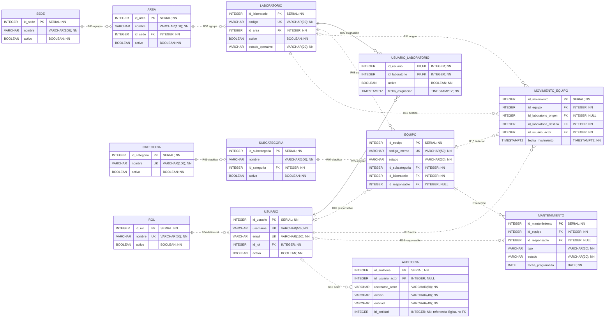

# ERD lógico v3 — Inventario de Laboratorios

La fuente de verdad es [Flyway V1–V13](../../backend/inventario/src/main/resources/db/migration/),
contrastada con las [12 Entities JPA](../../backend/inventario/src/main/java/com/utec/inventario/entity/).
Revisión estática del 11 de octubre de 2026: **12 tablas, 98 columnas, 12 PK y 16 FK**.
`flyway_schema_history` es infraestructura y no integra el modelo de negocio.
Esta tarea documenta la estructura; no ejecuta migraciones ni modifica datos.

[Abrir diagrama ampliable SVG](erd-logico-v3.svg) · [Imagen PNG](erd-logico-v3.png) ·
[Fuente Graphviz editable](erd-logico-v3.dot) · [ERD físico completo](erd-fisico-v3.md)

## Entidades implementadas

| Bloque | Entidades | Función |
|---|---|---|
| Organización | Sede, Área, Laboratorio | Ubicación institucional del inventario. |
| Clasificación | Categoría, Subcategoría | Clasificación de los equipos. |
| Identidad y alcance | Rol, Usuario, UsuarioLaboratorio | Autenticación, permisos y asignaciones de laboratorio. |
| Inventario | Equipo | Identificación, ubicación, responsable y estado del bien. |
| Mantenimiento | Mantenimiento | Programación y ciclo de mantenimiento de un equipo. |
| Trazabilidad | MovimientoEquipo, Auditoría | Historial de traslados y eventos administrativos. |

## Diagrama editable en Mermaid

Se muestran atributos principales; el ERD físico incluye las 98 columnas.
`||` indica uno, `o|` cero o uno y `o{` cero o muchos. La línea continua representa
una FK identificadora (parte de la PK); la discontinua, una FK no identificadora.
Todas las líneas de relación corresponden a FK reales.

## Relaciones y cardinalidades

Cada registro hijo tiene la cantidad indicada de padres; cada padre puede tener
cero o muchos hijos. Las referencias opcionales admiten NULL, pero un ID informado
siempre debe existir. Los códigos R01–R16 coinciden entre SVG, Mermaid y esta tabla.

| # | Referenciada (A) | Tabla hija (B) / FK | A por B | B por A | Significado |
|---|---|---|---|---|---|
| R01 | Sede | `area.id_sede` | 1 | 0..N | agrupa |
| R02 | Área | `laboratorio.id_area` | 1 | 0..N | agrupa |
| R03 | Categoría | `subcategoria.id_categoria` | 1 | 0..N | clasifica |
| R04 | Rol | `usuario.id_rol` | 1 | 0..N | define rol |
| R05 | Usuario | `usuario_laboratorio.id_usuario` | 1 | 0..N | asignación |
| R06 | Laboratorio | `usuario_laboratorio.id_laboratorio` | 1 | 0..N | asignación |
| R07 | Subcategoría | `equipo.id_subcategoria` | 1 | 0..N | clasifica |
| R08 | Laboratorio | `equipo.id_laboratorio` | 1 | 0..N | ubicación |
| R09 | Usuario | `equipo.id_responsable` | 0..1 | 0..N | responsable |
| R10 | Equipo | `movimiento_equipo.id_equipo` | 1 | 0..N | historial |
| R11 | Laboratorio | `movimiento_equipo.id_laboratorio_origen` | 0..1 | 0..N | origen |
| R12 | Laboratorio | `movimiento_equipo.id_laboratorio_destino` | 1 | 0..N | destino |
| R13 | Usuario | `movimiento_equipo.id_usuario_actor` | 1 | 0..N | actor |
| R14 | Equipo | `mantenimiento.id_equipo` | 1 | 0..N | recibe |
| R15 | Usuario | `mantenimiento.id_responsable` | 0..1 | 0..N | responsable |
| R16 | Usuario | `auditoria.id_usuario_actor` | 0..1 | 0..N | actor |

## Cómo interpretar el modelo actual

- **Usuario ↔ Laboratorio es N:M**, resuelto por UsuarioLaboratorio. Su PK es
  `(id_usuario, id_laboratorio)`; no existe un ID independiente de asignación.
- **Rol define qué puede hacer el usuario; la asignación activa define dónde.**
  ADMIN tiene alcance global según los servicios. Ser responsable de Equipo o
  Mantenimiento no concede permisos ni una asignación al laboratorio.
- Laboratorio tiene `activo` (baja lógica) y `estado_operativo`
  (OPERATIVO/MANTENIMIENTO), que son conceptos independientes.
- Equipo usa `estado=BAJA` para baja lógica; no tiene columna `activo`.
- MovimientoEquipo distingue origen, destino y actor. El origen es nullable en
  SQL para registros históricos; la API de traslado obtiene el origen real del Equipo.
- Mantenimiento referencia Equipo y un responsable opcional. Su laboratorio se
  obtiene a través de Equipo; no existe una FK directa Mantenimiento–Laboratorio.
- Auditoría tiene solo una FK: el actor opcional. `entidad` + `id_entidad` es una
  referencia lógica al objeto del evento, **no una FK a todas las tablas**.
  `username_actor` conserva el nombre del actor incluso si su FK queda NULL.
- Los reportes consultan/agregan tablas existentes; no hay entidad ni tabla Reporte.
- Las bajas lógicas preservan filas, claves y relaciones. Las reglas de alcance,
  actividad, traslado y ciclo de mantenimiento se aplican en servicios; el ERD
  describe estructura y no sustituye la [matriz de permisos](../matriz-permisos.md).

## Cambios respecto a v2

V2 corresponde a V1–V9: diez entidades y trece FK. V3 conserva su estructura e
incorpora V10 (estado operativo del Laboratorio), V11 (unicidad IgnoreCase del
email), V12 (Mantenimiento y dos FK) y V13 (Auditoría y una FK).
Todas las doce entidades están implementadas. Los documentos v2 y PDF originales
se conservan como históricos, accesibles desde el [índice de diagramas](README.md).
