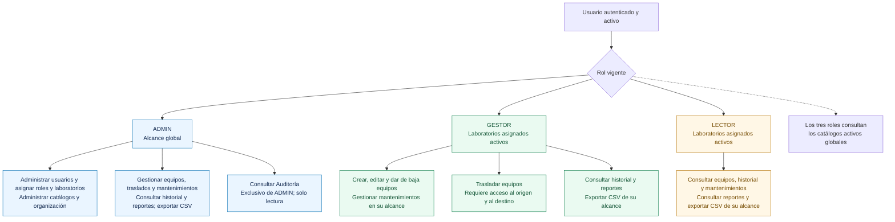

# Matriz de roles y permisos — ADMIN, GESTOR y LECTOR

Este documento compara qué puede hacer cada rol y sobre qué laboratorios.
Incluye una tabla funcional, un gráfico Mermaid y un ejemplo de traslado.
La tabla incorpora la exportación CSV y el acceso exclusivo de ADMIN a Auditoría.

**Revisión documental:** 26 de octubre de 2026. La evidencia Docker del
3 de octubre corresponde al commit `e1ce75a`; no acredita los cambios nuevos
de navegación, Auditoría y CSV ni su despliegue remoto.
Fuente: [SecurityConfig](../backend/inventario/src/main/java/com/utec/inventario/config/SecurityConfig.java)
y Services actuales. La [evidencia Docker/Actions](despliegue/verificacion-docker-actions-2026-10-03.md)
incluye las extensiones posteriores a Sprint 7. V9/233 y las 42 operaciones
originales corresponden a aquel cierre histórico, no al alcance actual V13/70.

## 1. Rol y alcance

El rol define **qué operación**; UsuarioLaboratorio define **dónde**.
ADMIN administra globalmente. GESTOR/LECTOR requieren asignación activa
a Laboratorio activo para operar sobre Equipo/Mantenimiento.
Los cinco catálogos activos son de lectura global para los tres roles.
`equipo.id_responsable` representa custodia y **no concede permisos**.

Historial de Movimiento usa origen **o** destino dentro del alcance actual.
Mantenimiento usa el Laboratorio actual del Equipo. Reportes aplican alcance
en servidor; un filtro explícito fuera de alcance se rechaza con 403.
ADMIN conserva consulta histórica de equipos y movimientos globalmente.

### Comparación para explicar los tres roles

| Acción de usuario | ADMIN | GESTOR | LECTOR |
|---|---|---|---|
| Consultar equipos, movimientos y mantenimientos | Global | Laboratorios autorizados | Laboratorios autorizados |
| Crear/editar/dar de baja equipos | Sí | En sus laboratorios | No |
| Trasladar equipos | Sí | Acceso al origen y al destino | No |
| Programar y cambiar estados de mantenimiento | Sí | En sus laboratorios | No |
| Consultar reportes y descargar CSV de agregados | Global | Laboratorios autorizados | Laboratorios autorizados |
| Consultar catálogos activos | Sí | Sí, global | Sí, global |
| Administrar catálogos y organización | Sí | No | No |
| Administrar usuarios, asignar roles y laboratorios | Sí | No | No |
| Consultar Auditoría | Sí, solo lectura | No | No |

Las acciones también cumplen las reglas de negocio: por ejemplo, un equipo en
mantenimiento EN_PROCESO no puede editarse, darse de baja o trasladarse.

El gráfico resume permisos. Todas las operaciones respetan las validaciones de
negocio de la tabla; exportar CSV no concede permisos de modificación. El rol
ADMIN permite asignar los tres roles existentes, sin crear roles o permisos nuevos.

**Ejemplo:** un GESTOR con acceso al laboratorio A puede gestionar sus equipos.
Para trasladar uno de A a B necesita además acceso activo a B. Si únicamente
conserva A después del traslado, puede consultar el movimiento por su origen,
pero no el detalle actual del equipo situado en B. Un LECTOR con A consulta
su información autorizada y descarga sus agregados, sin ejecutar el traslado.
ADMIN consulta y gestiona globalmente, sujeto a las mismas reglas de integridad.

En Jason, **Usuarios**, **Asignaciones** y **Auditoría** son entradas ADMIN.
Configuración queda retirada del menú y de las rutas. La autorización del
servidor sigue siendo obligatoria aunque un enlace se oculte en la interfaz.
La [guía de uso](frontend/guia-reportes-auditoria.md) detalla los CSV y la auditoría.

## 2. Operaciones implementadas

| Operación / rutas | ADMIN | GESTOR | LECTOR | Alcance |
|---|---|---|---|---|
| POST `/api/auth/login` | Sí | Sí | Sí | Público; identidad/contraseña válidas y cuenta/rol activos |
| GET `/api/auth/me` | Sí | Sí | Sí | Perfil propio |
| GET `/api/auth/me/laboratorios` | Global activo | Asignaciones activas | Asignaciones activas | Principal autenticado; no recibe idUsuario |
| GET categorías/subcategorías/sedes/áreas/laboratorios y jerarquías | Sí | Sí | Sí | Catálogo global activo |
| POST/PUT/DELETE de los cinco catálogos | Sí | No | No | Global; reglas de padres/dependencias |
| PATCH `/{catalogo}/{id}/estado` | Sí | No | No | Activación/desactivación con mismas reglas de integridad |
| GET `/api/admin/{catalogo}` | Sí | No | No | Global; filtro opcional activo, incluye inactivos si se solicita |
| GET `/api/admin/usuarios` y `/{id}` | Sí | No | No | Todos los usuarios; DTO público |
| POST `/api/admin/usuarios` | Sí | No | No | Alta administrativa; no registro público |
| PUT `/api/admin/usuarios/{id}` | Sí | No | No | Nombre/apellido/email/cargo; no cambia username, rol ni password |
| PATCH `/api/admin/usuarios/{id}/estado` o `/rol` | Sí | No | No | No puede desactivar/degradar último ADMIN activo |
| PUT `/api/admin/usuarios/{id}/password` | Sí | No | No | Restablecimiento administrativo; 204 sin secreto en respuesta |
| GET/PUT `/api/admin/usuarios/{idUsuario}/laboratorios` | Sí | No | No | Asignaciones explícitas; reemplazo atómico; destinatario puede estar inactivo |
| GET `/api/equipos` y `/{id}` | Global | En alcance | En alcance | Ubicación actual; BAJA consultable |
| GET `/api/admin/equipos` | Sí | No | No | Listado global |
| POST/PUT/DELETE `/api/equipos` | Global | En alcance | No | No BAJA; PUT/DELETE bloqueados con mantenimiento EN_PROCESO |
| POST `/api/equipos/{idEquipo}/traslados` | Global | Origen y destino | No | Destino activo/distinto; sin mantenimiento EN_PROCESO |
| GET `/api/movimientos` y `/api/equipos/{idEquipo}/movimientos` | Global | Historia visible | Historia visible | Origen O destino en alcance; no depende solo de ubicación actual |
| GET `/api/mantenimientos` y `/{id}` | Global | En alcance | En alcance | Laboratorio actual del Equipo |
| POST/PUT `/api/mantenimientos`, PATCH `/{id}/estado` | Global | En alcance | No | Equipo vigente, ciclo/transiciones válidas |
| GET `/api/reportes/resumen`, `/equipos/por-estado`, `/equipos/por-laboratorio`, `/movimientos`, `/mantenimientos` | Global | En alcance | En alcance | Filtros, fechas y permisos en servidor |
| GET `/api/admin/auditoria` | Sí | No | No | Consulta administrativa y filtros; sin endpoint de escritura libre |

En las rutas abreviadas de catálogo, los cinco nombres reales son
`categorias`, `subcategorias`, `sedes`, `areas` y `laboratorios`.
Las 70 rutas exactas, sus contratos y códigos están en [endpoints](backend-final/endpoints.md).
GET de salud Actuator es público y técnico, separado del total de aplicación.
El resto sin regla autorizada se deniega mediante `anyRequest().denyAll()`.

## 3. Respuestas de seguridad

| Caso | Resultado |
|---|---|
| Ruta protegida sin JWT, token inválido/vencido, usuario/rol inactivo | 401 |
| Rol insuficiente, incluido LECTOR intentando escribir | 403 |
| GESTOR/LECTOR solicita administración de usuarios/auditoría | 403 |
| Filtro o detalle existente fuera del alcance permitido | 403 |
| Alcance vacío y consulta de listado sin laboratorio explícito | 200, lista vacía |
| GESTOR solo tiene origen o solo destino de traslado | 403 sin UPDATE ni Movimiento |
| Equipo fuera del alcance actual con movimientos visibles | Historial 200 parcial; detalle Equipo sigue 403 |
| Usuario destinatario inactivo configurado por ADMIN | Asignaciones permitidas; login continúa bloqueado |
| Último ADMIN activo desactivado o degradado | 409 |
| Equipo con mantenimiento EN_PROCESO editado/dado de baja/trasladado | 409 |

Actor y origen de traslado se resuelven en servidor; enviarlos en el request
produce 400. El rol enviado al **cambio administrativo de rol** es el nuevo
rol del destinatario, autorizado previamente por ADMIN; nunca concede al
cliente el rol del actor.

## 4. Vigencia y backlog

Usuarios administrativos, reactivación de catálogos, Mantenimiento,
Reportes y Auditoría están **IMPLEMENTADOS**. No son pendientes del cierre
actual. El [Sprint 7](sprints_realizados-backend/sprint-7.md) conserva que
entonces estaban fuera de su alcance; las extensiones posteriores no
reescriben esa historia.

No existen registro público, CRUD del catálogo Rol, refresh token, permisos
dinámicos ni borrado físico de Equipo. Estas propuestas y la comprobación del
flujo autenticado remoto están en el [backlog](backend-final/backlog.md), separados de bugs.
La comprobación Docker histórica no reejecutó JUnit: 94 HTTP/30 aserciones
son otra evidencia distinta de las suites backend y frontend.

**Comprobación local del 26 de octubre, actualizada el 27:** el recorrido con
API/BD reales aprobó 8/8 comprobaciones, sin errores de página. ADMIN pudo
consultar Auditoría; GESTOR y LECTOR mantuvieron su alcance y no accedieron a
esa pantalla/API. Se verificaron CSV y filtro L201. La cuenta Jorge se usó
temporalmente como LECTOR y quedó restaurada a GESTOR. Ver
[evidencia y límites](despliegue/verificacion-cierre-2026-10-27.md).
