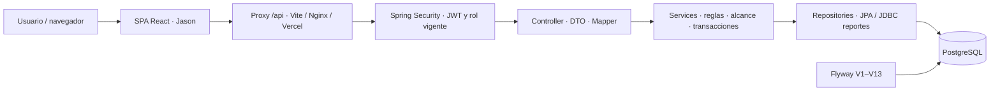

# Memoria del proyecto — Inventario de Laboratorios

## Arquitectura general

**Aplicación cliente-servidor de tres niveles en un monorepo:** una SPA React de
Jason consume una API REST Spring Boot organizada por capas; PostgreSQL conserva
los datos. Un proxy `/api` une frontend y backend. El navegador nunca accede
directamente a PostgreSQL. El backend es un monolito modular por capas, compilado
como un JAR; no hay microservicios. Flyway administra el esquema V1–V13 y
Hibernate lo valida.

**Organización del 26 de octubre de 2026:** el frontend y los sprints de Marko
se conservan solo en la computadora local. `frontend/version-marko/` y
`docs/sprints_realizados-frontend-Marko/` están excluidas mediante `.gitignore`
y retiradas del índice con `git rm --cached`; no se borraron sus archivos.
Los clones nuevos incluyen Jason como única variante frontend y no incluyen
los sprints de Marko. El historial Git anterior sigue disponible; las referencias
documentales a esas fuentes apuntan al commit histórico `0344b33`.



**Corte de esta memoria: 26 de octubre de 2026, America/Lima.** Se contrastaron
código, configuración, lockfiles, JAR/reportes históricos, herramientas instaladas,
GitHub Actions y conversaciones identificadas. Las observaciones operativas de
hoy no deben confundirse con las del 3 u 11 de octubre. Esta memoria es local y
versionable; no contiene contraseñas, JWT, dumps ni hashes de contraseñas.

### Versiones de programas y componentes

| Elemento | Versión | Tipo de evidencia / alcance |
|---|---|---|
| Aplicación backend | `0.0.1-SNAPSHOT` | `build.gradle.kts` |
| Java del proyecto / equipo | toolchain **21** / Oracle **21.0.12+7-LTS-205** | Declaración / instalación local |
| Gradle Wrapper | **9.7.1** | `gradle-wrapper.properties`; sin ejecutar resolución nueva |
| Spring Boot / dependency-management | **4.1.1 / 1.1.7** | Plugins declarados |
| Spring Framework / Security / Data JPA | **7.0.9 / 7.1.1 / 4.1.1** | Bibliotecas del JAR local histórico del 3 de octubre |
| Hibernate ORM / Validator | **7.4.5.Final / 9.1.3.Final** | Mismo JAR histórico |
| Flyway / driver PostgreSQL JDBC | **12.4.0 / 42.7.13** | Mismo JAR; no son la versión del servidor PostgreSQL |
| MapStruct / JJWT / Lombok binding | **1.6.3 / 0.13.0 / 0.2.0** | Declarados; Lombok sin versión explícita, gestionado por BOM |
| PostgreSQL Windows | Binarios **18.6**, servicio principal 18 activo | No hubo `SELECT version()` ni lectura autenticada del esquema |
| PostgreSQL Docker | `postgres:18-alpine` | Etiqueta declarada; patch/runtime actual no inspeccionado |
| Jason, versión de paquete | **1.0.0** | Frontend integrado |
| Jason React / React DOM | **18.3.1 / 18.3.1** | Lockfile e instalación local |
| Jason Vite / plugin React | **6.4.3 / 4.7.0** | Lockfile; los rangos de package.json son distintos |
| Jason Router DOM / Axios / Lucide | **7.18.4 / 1.20.0 / 0.468.0** | Lockfile |
| Marko, versión de paquete | **0.0.0** | Evidencia de la copia local de tutoría pausada, excluida de Git |
| Marko React / Vite / ESLint | **19.3.0 / 8.3.2 / 10.10.0** | Lockfile local/histórico; no describe el frontend desplegado |
| Node.js / npm del equipo | **24.16.0 / 11.13.0** | Ejecutables consultados hoy |
| Node del build Docker / CI | `node:22-alpine` / **22** | Declarado; patch no fijado |
| Nginx del frontend Docker | `nginx:stable-alpine` | Etiqueta móvil; versión exacta no verificada |
| Java de imágenes Docker | `eclipse-temurin:21-jdk` / `21-jre-alpine` | Build / runtime declarados |
| Docker Desktop / CLI / Compose | **4.92.0 / 29.8.0 / 5.5.1** | Instalados; Engine inaccesible hoy, versión de servidor no determinada |
| Git / GitHub CLI | **2.54.0.windows.1 / 2.101.0** | Instalación local |
| PowerShell / Python | **7.6.5 / 3.14.6** | Herramientas locales; Python no es runtime de la aplicación |
| VS Code / Postman / pgAdmin 4 | **1.143.1 / 12.31.7 / 9.17** | Registro/metadatos locales; herramientas de desarrollo |
| Windows | **11 Home**, `10.0.26200`, build **26200**, 64 bits | Sistema anfitrión |
| Render / Vercel / GHCR | Servicios alojados; sin versión de runtime efectiva confirmada | No inferirla de versiones del equipo ni de Dockerfiles |

Más versiones: [backend y dependencias del JAR](docs/memory/backend-database.md),
[todas las dependencias directas de ambos frontends](docs/memory/frontend.md) y
[herramientas, imágenes y acciones CI](docs/memory/docker-deployment.md).
Los árboles transitivos frontend completos están en sus `package-lock.json`.
No se inventa una versión exacta cuando solo se dispone de un rango, BOM o tag.

## Lectura inicial y fuentes de autoridad

Esta es la memoria canónica. Leer primero este archivo y después el anexo de la
parte que se vaya a cambiar:

| Documento | Contenido |
|---|---|
| [Backend y base de datos](docs/memory/backend-database.md) | Capas, seguridad, endpoints, tablas, V1–V13, reglas, concurrencia, pruebas y límites de BD viva |
| [Frontend](docs/memory/frontend.md) | Jason, antecedentes locales/históricos de Marko, versiones, rutas, sesión, API, módulos, pruebas y pendientes |
| [Docker y deployment](docs/memory/docker-deployment.md) | Tres modos de ejecución, puertos, variables, volumen, CI/GHCR, nube y runbooks |
| [Historia y decisiones](docs/memory/history-decisions.md) | Evolución, sprints, decisiones del usuario, 11 chats recuperados y asuntos no confirmados |
| [Registro de verificación](docs/memory/verification-2026-10-26.md) | Qué se comprobó hoy, qué fue histórico y qué queda por comprobar |
| [Snapshot de fuentes](docs/memory/snapshot-2026-10-26.json) | Auditoría inicial: HEAD y SHA-256 de fuentes, incluidas cinco rutas de Marko ahora solo locales; no es un manifiesto del árbol publicado tras la reorganización |

Orden para resolver discrepancias: **instrucción actual del usuario → código y
configuración actuales → comprobación fechada del entorno específico → evidencia
histórica → planes/propuestas**. Que una función exista en fuente no acredita
qué commit ejecuta la nube. Un reporte antiguo aprobado no equivale a una suite
recién ejecutada. Para datos vivos, la autoridad es la instancia concreta de BD.

## Identidad, ubicación y mapa del repositorio

- Workspace local: `C:\Users\marko\Desktop\fullstackweb\Proyecto`.
- Raíz Git: `C:\Users\marko\Desktop\fullstackweb\Proyecto\v2\inventario-laboratorios\inventario-laboratorios`.
- Repositorio: [markopuch/inventario-laboratorios](https://github.com/markopuch/inventario-laboratorios), rama local `main`.
- HEAD al inicio: `0344b3301c93f5b50894fbf454a21c7b129af37b`, `erd update`, **11 de octubre de 2026, 18:23:36 Lima**.
- El árbol estaba limpio antes de añadir esta memoria. La comparación con `origin/main` usa la referencia local; no se hizo fetch/pull.
- `v1.zip`, en el workspace superior, es un archivo histórico conservado; no se extrajo ni auditó como versión vigente.

```text
inventario-laboratorios/             ← raíz Git real
├─ AGENTS.md                        ← indica a futuras IA leer esta memoria
├─ memory.md                        ← este archivo
├─ .github/workflows/imagen.yml      ← construir/publicar dos imágenes
├─ .vscode/settings.json            ← Java stdio / configuración del editor
├─ backend/inventario/
│  ├─ build.gradle.kts, gradlew*, gradle/wrapper/
│  ├─ Dockerfile, docker-compose.yml, .dockerignore
│  └─ src/{main,test}/               ← Java y recursos/Flyway
├─ frontend/
│  ├─ version-jason/frontend/        ← SPA integrada, Dockerfile, Nginx, Vercel
│  └─ version-marko/inventario-frontend/ ← solo local, ignorada por Git
├─ docs/
│  ├─ memory/                       ← anexos de esta memoria
│  ├─ Erd_actual/                   ← modelo V13 y ERD v3; v2 histórico
│  ├─ backend-final/                ← contratos, reglas y entrega
│  ├─ despliegue/                   ← evidencia histórica Docker/Actions
│  ├─ sprints_realizados-backend/
│  ├─ sprints_realizados-frontend-Jason/
│  ├─ sprints_realizados-frontend-Marko/ ← solo local, ignorada por Git
│  └─ frontend/                     ← plan y mockups
├─ iniciar-backend.ps1
└─ verificar-backend.ps1
```

## Arquitectura interna y contratos esenciales

### Backend

Paquete raíz **`com.utec.inventario`**. Son **19 controllers y 70 operaciones
HTTP** contadas en las anotaciones actuales; Actuator aporta salud fuera de esos
controladores. Capas `controller`, `dto/request`, `dto/response`, `mapper`,
`domain`, `service`, `repository`, `entity`, `security`, `config` y `exception`.
DTO evita exponer entidades y campos privados; MapStruct transforma modelos.
Los servicios validan rol/alcance y coordinan transacciones/bloqueos; los
repositorios usan JPA y los reportes agregan con JDBC parametrizado.

Autenticación: `POST /api/auth/login` recibe `{ userName, password }`; devuelve
`accessToken`, `tokenType`, `expiresIn` y `usuario`. JWT **HS256**, issuer
`inventario-laboratorios`, duración por defecto **1800 segundos**, secreto Base64
externo de al menos 32 bytes. El backend recarga usuario/rol/actividad de BD en
cada solicitud. No hay sesión HTTP, refresh token ni revocación por logout.
BCrypt guarda contraseñas; restablecerlas no invalida automáticamente JWT emitidos.
Las rutas desconocidas terminan en `denyAll()`.

| Rol | Operaciones y alcance |
|---|---|
| ADMIN | Administración global, usuarios, catálogos, organización y auditoría |
| GESTOR | Gestión de equipos, traslados y mantenimientos dentro del alcance asignado |
| LECTOR | Consultas dentro del alcance asignado |

El alcance no administrativo exige asignación `usuario_laboratorio` activa y
laboratorio activo. Custodia/responsable de equipo no concede permisos. Los
catálogos generales son consultables y no sustituyen `/api/auth/me/laboratorios`.

Grupos API: `/api/auth`, catálogos/organización, `/api/admin/usuarios`,
`/api/equipos`, `/api/movimientos`, `/api/mantenimientos`, cinco GET de
`/api/reportes` y `GET /api/admin/auditoria`. Ver [contratos por grupo](docs/memory/backend-database.md).
Errores controlados JSON: 400 validación, 401 autenticación, 403 permiso/alcance,
404 inexistencia, 409 conflicto y 500 genérico. Altas suelen devolver 201,
actualizaciones 200 y bajas lógicas 204.

### Base de datos

Modelo fuente vigente: **V1–V13, 12 tablas de negocio, 98 columnas, 16 FK**.
`flyway_schema_history` es infraestructura adicional. Jerarquías principales:

```text
sede → area → laboratorio → equipo ← subcategoria ← categoria
rol → usuario ↔ usuario_laboratorio ↔ laboratorio
usuario → equipo (responsable opcional)
equipo → movimiento_equipo (origen/destino/actor)
equipo → mantenimiento (responsable opcional)
usuario → auditoria (actor opcional)
```

PK simples INTEGER/SERIAL; `usuario_laboratorio` usa PK compuesta. Timestamps con
zona se representan como TIMESTAMPTZ/OffsetDateTime; programación de mantenimiento
es DATE/LocalDate. Los reportes no tienen tabla propia. Auditoría no reconstruye
todas las versiones históricas de atributos.

Flyway crea/modifica el esquema al arrancar; `ddl-auto=validate` y
`open-in-view=false`. No editar migraciones ya aplicadas para cambiar el esquema;
añadir la siguiente versión. V4 siembra roles y catálogos, **no cuentas de acceso**.
Los ERD v3 representan V13; los ERD v2/PDF antiguos y la colección Postman de
cierre V9 deben interpretarse según su fecha. Detalle: [modelo V13](docs/Erd_actual/modelo-vigente-v13.md).

### Reglas que no deben perderse

- Baja de Equipo es lógica, estado `BAJA`; conserva historial y no tiene reactivación. PUT no modifica código interno ni laboratorio.
- Traslado exige origen real del servidor, destino válido, actor autenticado y motivo; ubicación e historial se guardan en una transacción.
- Un GESTOR necesita alcance en origen y destino; los movimientos se consultan por alcance actual de origen **o** destino, no solo por ubicación actual del equipo.
- Mantenimiento: PROGRAMADO → EN_PROCESO → COMPLETADO/CANCELADO, con cancelación directa desde PROGRAMADO. Solo uno EN_PROCESO por equipo.
- Iniciar mantenimiento guarda estado previo y pone Equipo en MANTENIMIENTO; finalizar/cancelar desde EN_PROCESO restaura el estado anterior. EN_PROCESO bloquea editar, dar de baja y trasladar.
- `laboratorio.activo` y `laboratorio.estadoOperativo` son independientes. Estado operativo MANTENIMIENTO no equivale a desactivar el laboratorio.
- No desactivar padres con hijos/asignaciones/equipos vigentes que las reglas protegen; inactivos conservan nombres/códigos reservados.
- PUT de asignaciones reemplaza el conjunto completo; `[]` lo vacía. Se validan todos los IDs antes del cambio y se conservan asociaciones históricas.
- No degradar/desactivar al último ADMIN activo. Preservar locks y restricciones concurrentes, no solo validaciones previas.
- Auditoría se registra dentro de la transacción de negocio y no guarda contraseñas/tokens. Sus eventos no se escriben libremente desde la API.
- Filtros de timestamps en reportes usan días UTC; mantenimiento usa fecha de calendario. Mantener esa semántica al trabajar desde Lima.

### Frontend

**Jason es la aplicación funcional e integrada**, por configuración y por decisión
expresa del usuario para Vercel. JavaScript/JSX, BrowserRouter, AuthContext,
Axios, CSS propio y Lucide. Carpetas: `pantallas`, `componentes`, `contextos`,
`servicios/api.js` y `utilidades`. Las pantallas guardan estado con hooks.

Rutas: `/login`, `/`, `/equipos`, `/categorias` (alias `/catalogo`),
`/laboratorios`, `/usuarios`, `/asignaciones`, `/movimientos`, `/mantenimientos`,
`/reportes` y `/configuracion`. Usuarios/asignaciones/configuración son ADMIN.
Configuración es placeholder: tiene ruta ADMIN, pero su entrada lateral está
deshabilitada como «Próximamente». No existe pantalla de Auditoría. Usuarios,
catálogos, equipos, traslados, mantenimiento y reportes sí consumen contratos reales.

JWT vive **solo en memoria**: recargar exige login. El acceso inicial usa perfil
devuelto por login y consulta alcance; el refresco de perfil usa `/auth/me` y
`/auth/me/laboratorios`. No es un refresh token. Un 401 vigente cierra la sesión;
403 conserva sesión. Se controlan respuestas asíncronas obsoletas. Timeout Axios:
15 segundos. Los botones/guards no reemplazan autorización en el servidor.

**Marko está pausado en la base FE-00/preparación FE-01 y conservado solo localmente**:
App mínima, proxy y cliente fetch; no tiene login o módulos montados equivalentes
a Jason. Su React 19 y Vite 8 no son las versiones que utiliza la aplicación
integrada. Su código y sprints están ignorados por Git desde el 26 de octubre;
no forman parte de un clon nuevo ni son dependencias de Jason, backend, Compose
o CI. No borrarlos del disco ni forzar su incorporación con `git add -f`.

## Ejecución, Docker y despliegue

| Modo | Recorrido | Particularidades |
|---|---|---|
| Desarrollo nativo | Vite `5173` → proxy `/api` → Spring `8080` → PostgreSQL Windows `5432` | Script de backend solicita credenciales; requiere entorno de proceso |
| Docker local | `127.0.0.1:3000` → Nginx `80` → backend `8080` → `db:5432` | Tres servicios, un Compose; backend también expuesto en `127.0.0.1:8080` |
| Nube publicada | Vercel → rewrite `/api` → backend Render → BD Render | BD nueva independiente; release/variables/versión efectiva no inspeccionados en panel |

Compose canónico: [backend/inventario/docker-compose.yml](backend/inventario/docker-compose.yml),
proyecto `inventario-docker`. Volumen declarado `postgres_data`, nombre esperado
`inventario-docker_postgres_data`, montaje `/var/lib/postgresql`. PostgreSQL no
publica puerto al host. Nunca resolver un problema de conexión eliminando el volumen.

Variables por nombre: backend `DB_URL`, `DB_USER`, `DB_PASSWORD`, `JWT_SECRET`;
opcionales `PORT`, `JWT_EXPIRATION_SECONDS`. Compose requiere
`DOCKER_DB_PASSWORD` y `DOCKER_JWT_SECRET` en su `.env` privado. Inicializador
demo: perfil `dev` y `DEMO_USER_PASSWORD`, solo crea cuentas ausentes.
Frontend: `VITE_API_URL=/api`; proxy Vite Jason `API_PROXY_TARGET` opcional.
`VITE_*` se incorpora al build público y nunca debe contener secretos.

Spring no lee automáticamente el `.env` de Compose durante `bootRun`.
Usar [iniciar-backend.ps1](iniciar-backend.ps1) o establecer variables en el
proceso del editor/terminal. El script genera JWT_SECRET por proceso si falta;
al cambiarlo dejan de funcionar tokens firmados con la clave anterior.

CI: [imagen.yml](.github/workflows/imagen.yml) construye/publica imágenes separadas
backend y Jason en GHCR, tags `latest` y `sha-<commit>`. Jason ejecuta tests en
Node 22; Docker backend ejecuta `bootJar -x test`, **sin JUnit en el workflow**.
Publicar imágenes no despliega automáticamente contenedores ni copia la BD.

## Estado actual y evidencia

| Componente | Estado acreditado al 26 de octubre |
|---|---|
| Código backend/BD | Implementado el alcance ampliado V13 y 70 operaciones; no se inició backend hoy |
| Pruebas backend | 40 XML históricos del 3 de octubre: **319 aprobadas**, cero fallos/errores/omitidas; no se repitieron hoy |
| Jason | **67/67 tests aprobados hoy**, salida 0; prueba de lógica/contratos, sin build nuevo ni E2E |
| Marko local | **Lint aprobado en la auditoría del 26 de octubre**, salida 0; sigue sin login montado y ahora está excluido de Git |
| Docker | CLI/Desktop instalados; daemon Linux inaccesible, no se pudo inventariar estado real de contenedores/imágenes/volumen |
| Puertos locales | 3000/8080 rechazaron consultas; no se observó Vite en 5173. PostgreSQL Windows sí escucha en 5432 |
| Datos vivos Windows | No consultados: faltan credenciales SQL en el entorno; no se certifican esquema/migraciones/conteos actuales |
| Último Docker local documentado | `e1ce75a`, 3 de octubre: V13, tres servicios saludables y smoke aislado 94 HTTP/30 aserciones/7 SQL; es histórico |
| Última publicación CI visible | [run 38183985364](https://github.com/markopuch/inventario-laboratorios/actions/runs/38183985364), commit `b164c44`, ambos jobs success, 11 de octubre 18:23:14 Lima |
| Vercel hoy | [/login](https://inventario-laboratorios.vercel.app/login) responde HTTP 200 HTML |
| Render y proxy hoy | GET salud/proxy agotaron 35 y 50 segundos; estado indeterminado, sin atribuir causa |
| Login/flujos cloud | No acreditados. Historial confirma BD Render nueva sin importación; no confirma creación del primer ADMIN |

El 11 de octubre se observó Render `UP` y 401 JSON por el proxy Vercel. Esa
evidencia explica que hubo conectividad, pero no sustituye la comprobación actual.
El corte antiguo del backlog que decía «nube pendiente» quedó superado por la
publicación comunicada por el usuario; todavía falta acreditar el flujo autenticado.

## Pendientes concretos

1. **Cierre cloud:** verificar release/variables por nombre en Render/Vercel, salud/proxy y existencia del primer ADMIN; probar login, roles/alcance y flujo funcional con cuentas autorizadas.
2. **BD local:** cuando se disponga de acceso autorizado, consultar versión real, `flyway_schema_history`, esquema y conteos agregados de la instancia correcta, sin exportar registros privados.
3. **Docker local:** cuando responda su motor, comprobar contenedores, imágenes, tags/digests y volumen existente antes de cualquier actualización.
4. **Producto:** Configuración persistida, pantalla de Auditoría, exportación de reportes y calendario de mantenimiento siguen pendientes de priorización; no presentarlos como implementados.
5. **Mejoras de plataforma:** Swagger/OpenAPI, refresh/revocación, recuperación de contraseña, paginación, permisos dinámicos y operación avanzada no están implementados en el alcance revisado. Asignar roles sí existe; CRUD del catálogo Rol no.
6. **Calidad:** no hay verificación nueva de build, E2E, accesibilidad completa, carga o backups/restauración. CI backend omite JUnit; evaluar su integración si se pide.

Los pendientes no autorizan por sí mismos cambiar código o desplegar: orientan la
próxima petición. No se requieren Kubernetes ni una reestructuración del monorepo
para continuar el alcance existente.

## Instrucciones de continuidad y mantenimiento

1. Leer este archivo, el anexo pertinente y `git status` antes de editar.
2. Identificar versión frontend y entorno de BD. Evitar confundir Windows, Compose y Render.
3. Conservar contratos, migraciones aplicadas y datos. Para integración usar una BD de verificación dedicada; las suites backend escriben fixtures y `contextLoads` no tiene todos los guards de nombre.
4. No inferir credenciales actuales de ejemplos o chats antiguos. El password técnico PostgreSQL, el secreto JWT y la contraseña de usuario son distintos.
5. Actualizar memoria/fecha/fuentes cuando cambien versiones, arquitectura, contratos o deployment. El snapshot conserva la auditoría inicial; las cinco fuentes Marko pueden faltar en un clon nuevo por la exclusión deliberada, sin que eso indique un fallo.

Esta memoria resume conocimiento útil de **11 conversaciones recuperadas**, más
inspección técnica; algunas comparten historia por bifurcaciones. No sustituye el
código, un respaldo SQL o una nueva comprobación de producción. Los `AGENTS.md`
de workspace y repositorio ayudan a que futuras IA la descubran sin depender de
memoria automática entre chats. La auditoría inicial solo añadió documentación,
sin commits/push. La reorganización posterior autorizada retira del seguimiento
21 archivos de Marko y actualiza documentación/reglas de Git; conserva sus archivos
locales, el código activo, las migraciones y los datos. Sus comprobaciones se
registran en el [anexo de verificación](docs/memory/verification-2026-10-26.md).
